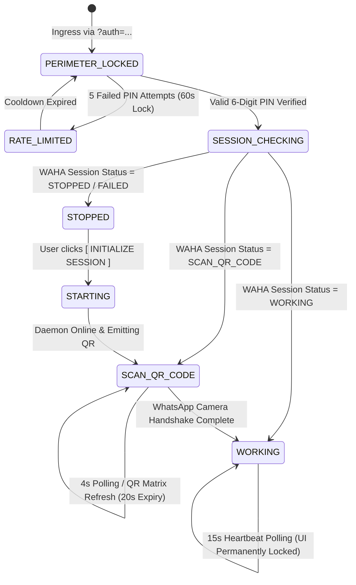

# WAHA Sentinel Gateway — Technical Architecture & Specifications

## 1. System Overview & Architectural Topology

WAHA Sentinel Gateway is an ultra-lightweight, hardened security proxy and single-purpose pairing portal engineered to bridge human operators with a containerized WhatsApp HTTP API (WAHA) daemon running in a Docker network (e.g. managed via Coolify).

### High-Level Topology

```
+--------------------------------------------------------------------------+
|                       PUBLIC INTERNET / OPERATOR VIEWPORT                |
|       (Mobile Safari / Android Chrome / Desktop Chrome & Firefox)        |
+--------------------------------------------------------------------------+
                                     |
                         HTTPS (Port 443 / TLS)
                                     v
+--------------------------------------------------------------------------+
|                  COOLIFY TRAEFIK REVERSE PROXY / INGRESS                 |
|       (SSL Termination, Automated Let's Encrypt, Security Headers)       |
+--------------------------------------------------------------------------+
                                     |
               Internal Bridge Network: `coolify` (Port 3000)
                                     v
+--------------------------------------------------------------------------+
|                       WAHA SENTINEL GATEWAY CONTAINER                    |
|   - Node.js 20 LTS Alpine Runtime (Express + Helmet + Proxy)             |
|   - Zero Leakage Proxy Engine (Client never sees WAHA API Key)           |
|   - Dual-Layer Perimeter: Cryptographic URL Token + 6-Digit Master PIN   |
|   - In-Memory IP Brute-Force Rate Limiter                                |
|   - Ultra-Fast Single Page Interface (Vanilla HTML5 + Tailwind + GSAP)   |
+--------------------------------------------------------------------------+
                                     |
               Internal DNS Network: `http://waha:3000` (Isolated)
                                     v
+--------------------------------------------------------------------------+
|                         WAHA CORE DAEMON CONTAINER                       |
|   - Session Engine (NOWEB / GOWEB)                                       |
|   - Target Session: strictly bound to `WAHA_SESSION` (default)           |
|   - No public ingress; administrative endpoints shielded from web        |
+--------------------------------------------------------------------------+
```

---

## 2. Security Perimeter & Access Model

The gateway implements a multi-layer zero-trust barrier:

1. **Perimeter Layer (URL Token Gate):**
   - Ingress requires a 64-character unguessable URL token (`?auth=SEC_...`).
   - If missing or invalid, an opaque forensic 403 Forbidden payload is served.
2. **Identity Layer (Segmented Master PIN Lock):**
   - 6-digit numeric Master PIN verification.
   - Client-side masked bullet formatting with instant tactile feedback.
   - In-memory rate limiting: 5 failed attempts locks authentication for 60 seconds per IP.
3. **Session Layer (HttpOnly Encrypted Cookie):**
   - Upon successful PIN verification, an encrypted HttpOnly session cookie (`sentinel_session`) with a 2-hour TTL is issued.
4. **Anti-Tamper & Anti-Overwrite Safeguards:**
   - Once a session transitions to `WORKING`, all logout, deletion, and session switching controls are strictly suppressed.
   - Phone whitelist enforcement (`ALLOWED_PHONE_NUMBER`): if enabled, scanning an unapproved number automatically terminates the unauthorized session immediately.

---

## 3. Finite State Machine (FSM)

The portal frontend operates across four discrete states synchronized in real time via dynamic polling:



---

## 4. Frontend Component & Design System Architecture

Conforming strictly to `UI_SPEC.md` and the **Anti-AI-Slop Standard**:

| Component | Archetype | Visual & Motion Specifications |
| :--- | :--- | :--- |
| **Canvas** | Daylight Alabaster | `#FAF9F5` base background with 1px `#E4E4E7` architectural grid lines. |
| **Cards** | Elevated Surface | `#FFFFFF` with `rounded-lg` (8px), 1px border `#E4E4E7`, micro-shadow `0 1px 2px rgba(0,0,0,0.05)`. Zero blurry drop shadows. |
| **Typography** | Technical Editorial | Display: `Inter` (-0.025em tracking). Telemetry & Numbers: `JetBrains Mono` (-0.01em tracking). |
| **PIN Lock Box** | Segmented Keypad | 6 individual 48x56px boxes, active box scaled 1.04x, GSAP tactile shake on error, smooth unlock card fade-out. |
| **QR Frame** | Precision Matrix | Technical corner crosshairs (L-shaped hair-lines), animated GSAP vertical radar sweep line, SVG circular countdown ring (20s cycle). |
| **Verified Shield** | Emerald Telemetry | GSAP scaleY morph transition, emerald badge with ping beacon, formatted JID typography (`+62 811-XXXX-XXXX`), locked anti-tamper watermark. |
| **Halted Recovery** | Diagnostic Terminal | Crimson badge, terminal cursor `>_`, `[ INITIALIZE SESSION ]` button morphing into segmented progress indicator. |
| **Footer** | Live Telemetry Bar | Fixed bottom status bar with WIB timestamp (`UTC+07:00 [WIB]`), ping latency telemetry, daemon version. |

---

## 5. API Endpoints Specification

### Ingress & Authentication
- `GET /` : Serves the Single Page Portal (evaluates `?auth=...` query token).
- `POST /api/auth/verify` :
  - **Payload:** `{ "pin": "string", "token": "string" }`
  - **Response 200:** `{ "success": true, "message": "AUTHENTICATED" }` (sets `sentinel_session` cookie).
  - **Response 401:** `{ "error": "INVALID_PIN", "remainingAttempts": number }`
  - **Response 429:** `{ "error": "RATE_LIMITED", "retryAfterSeconds": number }`

### Session Management & Telemetry
- `GET /api/session/status` :
  - **Headers:** Requires valid session cookie or perimeter auth.
  - **Response 200:**
    ```json
    {
      "session": "default",
      "status": "SCAN_QR_CODE | WORKING | STOPPED | STARTING | FAILED",
      "qr": "data:image/png;base64,...",
      "qrTtlSeconds": 20,
      "me": {
        "id": "62811xxxx@c.us",
        "pushName": "RSD Bot Monitor",
        "platform": "WhatsApp Web / macOS"
      },
      "engine": "NOWEB",
      "uptimeSeconds": 14205,
      "pingMs": 18
    }
    ```
- `POST /api/session/start` :
  - **Response 200:** `{ "success": true, "status": "STARTING" }`
- `POST /api/session/refresh-qr` :
  - Forces invalidation and fresh pull of the QR matrix bytes from WAHA.
