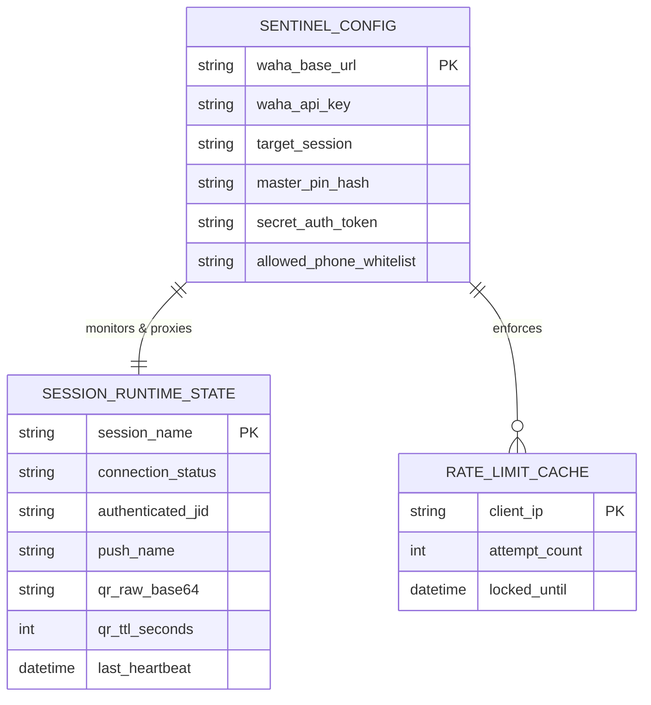

# PRD — WAHA Sentinel Gateway (Dedicated Session Scanner & Status Portal)

## 1. Overview
### 1.1 Background & Context
Modern enterprise automation architectures frequently deploy WAHA (WhatsApp HTTP API) within containerized Docker networks (managed via orchestration platforms like Coolify) to facilitate automated reporting, transactional notifications, and bidirectional customer engagement. However, WAHA's native administration interface (Swagger UI and raw API endpoints) exposes the entire WhatsApp infrastructure—including full chat histories, message dispatch capabilities, session deletion tools, and raw API tokens. Exposing this interface to non-technical operators or external field staff who only need to pair a WhatsApp device introduces severe operational vulnerabilities, risk of credential compromise, and unauthorized session mutations.

### 1.2 Core Problem Solved
Currently, connecting a WhatsApp number requires either granting operators direct access to the WAHA administrative dashboard or having a developer manually pull base64 QR codes from API terminals. Furthermore, without access controls and session guards, an unauthorized operator could easily scan a personal WhatsApp account into a shared business session, overwrite an active corporate number, or accidentally terminate active dispatch sessions.

### 1.3 Target Audience
1. **Corporate Operations & Field Personnel:** Authorized non-technical staff responsible for linking the official company SIM/phone to the automation system.
2. **DevOps & System Administrators:** Engineers managing Coolify containers who require an isolated, zero-maintenance, hardened microservice that shields WAHA internals from the public internet.

### 1.4 Value Proposition
WAHA Sentinel Gateway provides a dedicated, hardened, and visually polished single-purpose web portal. It isolates the WhatsApp pairing lifecycle into an intuitive, zero-leakage interface. Operators can inspect live connection health and scan pairing QR codes in real time, while all destructive administrative functions, sensitive chat logs, and API credentials remain 100% inaccessible.

### 1.5 System Objectives
- **Zero API Key Leakage:** The WAHA administrative token never touches the client browser; all communications are strictly mediated via a secure server-side proxy.
- **Dedicated Single-Session Binding:** The gateway is strictly bound to a designated WAHA session (`1 Session = 1 Dedicated Account`), preventing cross-tenant interference or session hijack.
- **Dual-Layer Access Control:** Perimeter enforcement via unguessable 256-bit cryptographic URL tokens combined with a master numeric PIN lock.
- **Real-Time Visual State Synchronization:** Low-latency polling and fluid state transitions (powered by GSAP 3.x) transitioning seamlessly across Disconnected, Awaiting Scan, and Connected states.
- **Anti-Tamper & Anti-Overwrite Safeguards:** Explicit omission of client-facing disconnect/logout controls once a session achieves `WORKING` state. Optional phone number whitelist verification immediately revokes unauthorized pairings.

---

## 2. High-Level Requirements

### 2.1 Target Platforms
- **Web & Mobile Viewports:** Responsive single-page web utility optimized for modern mobile devices (iOS Safari, Android Chrome) for direct camera-to-screen QR pairing, as well as desktop displays (macOS, Windows, Linux).
- **Deployment Platform:** Coolify-managed Docker container running inside the internal `coolify` Docker network.

### 2.2 Access Control & Multi-Tenancy (RBAC)
- **Role 1: Terminal Operator (Client-Side)**
  - Access granted strictly upon presentation of valid cryptographic token parameter (`?auth=...`) and successful entry of a 6-digit Master PIN.
  - Read permissions: View session health (`STOPPED`, `STARTING`, `SCAN_QR_CODE`, `WORKING`), active phone number identity, and dynamic QR image.
  - Write permissions: Execute non-destructive `Session Start` triggers if the daemon is halted. Zero permissions to delete, logout, read chats, or dispatch payloads.
- **Role 2: System Administrator (Server-Side / Coolify)**
  - Full configuration authority via environment variables (`WAHA_BASE_URL`, `WAHA_API_KEY`, `WAHA_SESSION`, `MASTER_PIN`, `ALLOWED_PHONE_NUMBER`).
  - Container health telemetry and Traefik reverse-proxy management.

### 2.3 Data Input & Ingestion Methods
- Client-side credential entry via a tactile numeric PIN keypad / input field.
- Server-side REST ingestion polling WAHA core endpoints:
  - `GET /api/sessions/{session}`: Retrieval of connection state and authenticated metadata.
  - `GET /api/{session}/auth/qr`: Retrieval of live SVG/PNG pairing matrices.
  - `POST /api/sessions/{session}/start`: Controlled session initialization.

### 2.4 Performance & Latency Benchmarks
- **Initial Load Time:** First Contentful Paint (FCP) under 350ms; Total Blocking Time (TBT) < 50ms.
- **Polling Interval:** Dynamic 4-second polling cadence during `SCAN_QR_CODE` status; drops to 15-second heartbeat once `WORKING` status is achieved.
- **State Transition Latency:** Instantaneous visual acknowledgement (<16ms frame budget, 60fps) via GSAP hardware-accelerated animations.
- **Container Footprint:** Lightweight Alpine Node.js / Go microservice consuming < 35MB RAM under peak load.

---

## 3. Comprehensive Pages & Core Features Mapping

### 3.1 Route: `/` (Perimeter Gate & Sentinel Dashboard)
The entire application is constructed as an ultra-fast, stateful Single Page Interface (SPI).

#### 3.1.1 State 1: Perimeter Lock Screen (Authentication Barrier)
- **Purpose:** Prevent unauthorized traffic, search crawler indexing, and brute-force intrusion.
- **Visual Components & Layout:**
  - Minimalist daylight canvas (`#FAF9F5`) with centered cryptographic access card (`#FFFFFF`).
  - Monospace gateway badge: `SENTINEL_GATE // ACCESS_RESTRICTED`.
  - Visual status pill indicating `SESSION_TARGET: default`.
  - 6-slot segmented PIN input box with active focus glow.
  - Virtual ergonomic keypad (optimized for touch screens) with tactile haptic-styled click states.
- **Detailed Elements & User Actions:**
  - Input field masks digits using monospace bullet characters (`•`).
  - Auto-submits upon entry of the 6th digit.
  - Rate-limit indicator: Locks input for 60 seconds after 5 consecutive incorrect attempts.
- **System & Backend Integration:**
  - Client sends `POST /api/auth/verify` with payload `{ pin: string, token: string }`.
  - Server sets an encrypted, HttpOnly session cookie (`sentinel_session`) with a 2-hour TTL upon verification.

#### 3.1.2 State 2: Session Polling & QR Scanner Hub (`SCAN_QR_CODE` Status)
- **Purpose:** Serve real-time WhatsApp pairing matrix with automatic refresh and countdown synchronization.
- **Visual Components & Layout:**
  - Top Navigation Bar: Session ID indicator (`SESSION: default`), Engine status (`ENGINE: NOWEB/GOWEB`), Live uptime clock.
  - Central Viewport: Architectural QR frame featuring 1px structural hair-lines and technical corner crosshairs.
  - Circular SVG countdown ring indicating remaining seconds until QR expiration (~20s cycle).
  - Status Badge: Amber warning indicator (`STATUS: SCAN_QR_CODE`).
  - Informational Micro-Card: Monospace instructions ("Open WhatsApp > Settings > Linked Devices > Point Camera").
- **Detailed Elements & User Actions:**
  - GSAP-powered pulse radar running continuously across the QR frame boundary.
  - "Force Refresh QR" secondary action pill for instant matrix invalidation and re-fetch.
- **System & Backend Integration:**
  - Polls `GET /api/session/status` every 4 seconds.
  - Backend queries WAHA `GET /api/sessions/{session}`. If QR is returned or status indicates `SCAN_QR_CODE`, backend fetches raw QR bytes and pipes to client as clean Base64 data URI.

#### 3.1.3 State 3: Active Sentinel Dashboard (`WORKING` Status)
- **Purpose:** Confirm pairing completion, display verified account metadata, and lock interface against unauthorized session changes.
- **Visual Components & Layout:**
  - GSAP morphing transition: QR frame collapses smoothly into an elevated Verified Account Identity Card.
  - Status Badge: Emerald green verification beacon (`STATUS: WORKING // CONNECTED`).
  - Account Metadata Grid:
    - Connected WhatsApp JID: `+62 811-XXXX-XXXX` (formatted with JetBrains Mono).
    - Device Push Name: (e.g., `RSD Monitoring Gateway`).
    - Connected Platform: (e.g., `WhatsApp Web / macOS / Android`).
    - Session Established Timestamp.
  - Locked Shield Watermark: Visual indicator confirming that Session Logout / Disconnect actions are strictly disabled in this gateway.
- **Detailed Elements & User Actions:**
  - Live heartbeat pulse confirming persistent WebSocket/HTTP socket health with WAHA.
  - Zero interactive logout buttons exist.

#### 3.1.4 State 4: Halted Session Recovery (`STOPPED` / `FAILED` Status)
- **Purpose:** Allow operators to revive a stopped WAHA daemon without accessing terminal or Coolify dashboard.
- **Visual Components & Layout:**
  - Status Badge: Crimson alert pill (`STATUS: STOPPED`).
  - Diagnostic message detailing daemon status (`Session daemon is dormant`).
  - Primary Action CTA: `[ INITIALIZE SESSION ]` button with high-contrast tactile border.
- **Detailed Elements & User Actions:**
  - Clicking CTA transitions button into a segmented indeterminate progress bar.
  - Triggers backend call `POST /api/session/start`.
  - Automatically transitions to State 2 (`SCAN_QR_CODE`) upon container startup.

---

## 4. User Flow & System Interaction

### 4.1 End-to-End Operational Trajectory
1. **Perimeter Check:** Operator taps secret link (e.g., `https://waha-scan.allure.co.id/?auth=SEC_9f4b29a17c0e8281...`).
2. **Access Evaluation:** Server inspects `auth` query parameter. If missing or invalid, an opaque `403 Access Denied` response is emitted.
3. **PIN Authentication:** Operator inputs the 6-digit Master PIN. The client initiates a GSAP shake animation if incorrect; if valid, a card-flip GSAP transition unlocks the Sentinel Hub.
4. **State Query:** Hub queries `/api/session/status`:
   - *Branch A (Session Dormant):* Operator clicks `Initialize Session`. Backend invokes WAHA `/start`. Gateway enters polling loop.
   - *Branch B (Session Awaiting Scan):* High-resolution QR code renders within technical bounding box. Countdown ring ticks from 20s to 0s. Operator scans using mobile WhatsApp.
   - *Branch C (Session Already Connected):* Verified green dashboard immediately renders. QR code is never exposed.
5. **Pairing Confirmation & Auto-Lock:** Upon scanning, WAHA reports status change to `WORKING`. Client-side GSAP timeline morphs the interface into the Connected state within 400ms. Disconnect controls remain inaccessible.

---

## 5. Technical Architecture

### 5.1 Infrastructure Topology
The microservice is deployed as an autonomous Docker container (`waha-sentinel`) running Node.js 20 on Alpine Linux. It is connected to the user's existing internal bridge network (`coolify`) alongside the `waha` container.
- Public ingress is managed by Coolify's Traefik reverse proxy handling automated TLS certificate issuance (Let's Encrypt).
- The WAHA core container does not map its listening port (`3000`) to the public host; it communicates strictly via internal DNS (`http://waha:3000`).

### 5.2 Sequence Diagram
```mermaid
sequenceDiagram
    autonumber
    actor Operator as Operator (Mobile/Desktop)
    participant Proxy as Traefik Ingress (SSL)
    participant Sentinel as WAHA Sentinel Gateway
    participant WAHA as WAHA Core Container (Internal)
    participant WA as WhatsApp Network

    Operator->>Proxy: GET /?auth=SEC_TOKEN
    Proxy->>Sentinel: Forward HTTP Request
    Sentinel-->>Operator: 200 OK (Render PIN Screen)
    
    Operator->>Sentinel: POST /api/auth/verify (PIN)
    alt Invalid PIN
        Sentinel-->>Operator: 401 Unauthorized (Trigger GSAP Shake)
    else Valid PIN
        Sentinel-->>Operator: 200 OK (Set HttpOnly Cookie)
    end

    loop Every 4s Polling
        Operator->>Sentinel: GET /api/session/status
        Sentinel->>WAHA: GET /api/sessions/default (Header: x-api-key)
        WAHA-->>Sentinel: 200 OK { status: "SCAN_QR_CODE" }
        Sentinel->>WAHA: GET /api/default/auth/qr
        WAHA-->>Sentinel: 200 OK (Raw Image Stream)
        Sentinel-->>Operator: JSON { status: "SCAN_QR_CODE", qr: "data:image/png;base64,..." }
    end

    Operator->>WA: Scans QR with WhatsApp Camera
    WA->>WAHA: Handshake Complete & Cryptographic Key Exchange
    WAHA->>WAHA: Update Internal State -> "WORKING"

    Operator->>Sentinel: GET /api/session/status
    Sentinel->>WAHA: GET /api/sessions/default
    WAHA-->>Sentinel: 200 OK { status: "WORKING", me: { id: "62811xxxx@c.us" } }
    
    opt Phone Whitelist Check Enabled
        Sentinel->>Sentinel: Validate me.id against ALLOWED_PHONE_NUMBER
        alt Unauthorized Phone Number
            Sentinel->>WAHA: POST /api/sessions/default/logout
            Sentinel-->>Operator: 403 Forbidden { error: "UNAUTHORIZED_PHONE_NUMBER" }
        end
    end

    Sentinel-->>Operator: 200 OK { status: "WORKING", user: "+62 811-XXXX-XXXX" }
    Note over Operator: GSAP Flip Animation: Displays Green Verified Shield
```

---

## 6. Database Schema & State Store

Because WAHA Sentinel Gateway operates as a lightweight, zero-maintenance stateless proxy, persistent operational states are derived directly from the WAHA container runtime and in-memory rate-limiter caches.

### 6.1 State Entity Relational Diagram


### 6.2 Data Field Specifications
| Entity | Field Name | Data Type | Description |
| :--- | :--- | :--- | :--- |
| `SENTINEL_CONFIG` | `waha_base_url` | String | Internal Docker DNS address (e.g., `http://waha:3000`). |
| `SENTINEL_CONFIG` | `target_session` | String | Dedicated session identifier (e.g., `default`). |
| `SENTINEL_CONFIG` | `master_pin_hash` | String | Scrypt / Argon2 hash of the 6-digit master access PIN. |
| `SENTINEL_CONFIG` | `secret_auth_token` | String | 64-character URL query token for perimeter access. |
| `SESSION_STATE` | `connection_status` | Enum | `STOPPED`, `STARTING`, `SCAN_QR_CODE`, `WORKING`, `FAILED`. |
| `SESSION_STATE` | `authenticated_jid` | String | Verified phone number JID (`62811xxxx@c.us`). |
| `RATE_LIMIT` | `locked_until` | Timestamp | Timestamp after which brute-force lock resets. |

---

## 7. Design & Technical Constraints

### 7.1 Tech Stack Recommendation
- **Backend Runtime:** Node.js 20 LTS (Alpine base) executing Express.js with Helmet and Http-Proxy-Middleware.
- **Frontend Architecture:** Single-file vanilla HTML5 / ES6 structure with zero heavy framework bloat. Eliminates hydration overhead and ensures sub-millisecond execution.
- **Animation & Motion Engine:** **GSAP 3.12+ (GreenSock Animation Platform)** with Flip and CustomEase plugins for high-precision, non-slop state transitions.
- **Styling Utility:** Tailwind CSS (configured for strict architectural constraints: hairline borders, zero pill cards, no mushy shadows).
- **Iconography:** Lucide Icons (stroke width: 1.5px technical wireframe).

### 7.2 UI System Reference
**MANDATORY:** All visual layout parameters, color tokens, typography scales, GSAP animation orchestration parameters, and anti-AI-slop rules MUST strictly conform to `UI_SPEC.md`.

### 7.3 Backend / Framework Documentation Standard
Any external library invocation or security middleware configuration MUST be cross-referenced against the latest official engine documentation standards (Context7 verified).

### 7.4 Typography Standards
- **Primary Technical Sans:** `Inter`, `Geist Sans`, or system `-apple-system, BlinkMacSystemFont, "Segoe UI", Roboto, sans-serif` (Strict high-contrast, `tracking-tight`).
- **Data & Metric Monospace:** `JetBrains Mono, "Courier New", monospace` (Used for all status codes, timestamps, phone numbers, JIDs, session IDs, and PIN inputs).

---

## 8. MANDATORY AI AGENT EXECUTION PROTOCOL & WORKFLOW RULES

### RULE A: Specification Verification Strategy
1. Before writing any code, the AI Agent MUST inspect `PRD.md`, `UI_SPEC.md`, and `.harness/EXPERIENCE.md`.
2. Any styling or behavioral conflict between defaults and `UI_SPEC.md` must be resolved strictly in favor of `UI_SPEC.md`.

### RULE B: Task Management System (3-File Task Tracker + QA Tracker)
The AI Agent MUST maintain and update four tracking files in the project root:
1. `tasks_todo.md` — Granular tasks pending execution.
2. `tasks_running.md` — The single active task being implemented.
3. `tasks_done.md` — Completed, verified tasks.
4. `qa_verification.md` — Quality verification records and test logs.

### RULE C: Execution Sequence
1. **PHASE 1:** Pure static prototype of HTML/CSS with GSAP animations.
2. **PHASE 2:** Node.js Express server implementation and Dockerfile configuration.
3. **PHASE 3:** Endpoint proxy wiring, WAHA API integration, and security hardening verification.

### RULE D: Security Standard Protocols (ISO 27001 Compliance)
- Enforce Least Privilege Principle: Client has zero awareness of WAHA API keys.
- Rate Limiting: Max 5 failed PIN attempts per IP per 5-minute window.
- All secrets loaded exclusively from environment variables (`process.env`).

### RULE E: Recursive Self-Refining Harness Protocol (Harness² Loop)
Follow the **HALT & TRACE -> PROPOSE -> PROBE -> COMPOSE** loop upon encountering runtime or build failures, persisting solutions into `.harness/EXPERIENCE.md`.

### RULE F: Cross-Project Global Harness Inheritance
Scan and inherit existing lessons from `.harness/` prior to task initialization.
